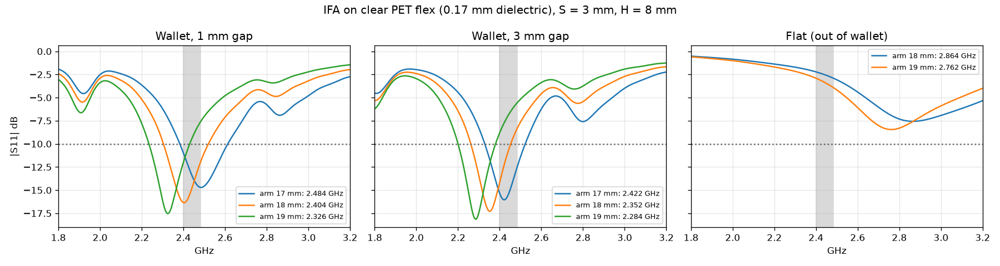

# IFA simulation results (openEMS)

Model: `ifa_openems.py`. Geometry from the board: H = 8 mm, S = 3 mm, W = 1 mm, ground pour 53 x 55 mm.
The substrate is JLC clear PET flex, modelled as 0.17 mm of dielectric (70 um core + 2 x 50 um coverlay; copper excluded).
Run with `source ~/.venvs/openems/bin/activate && python ifa_openems.py --case wallet --gap 1 --arm 18`.
Each run takes 2-4 min on the M5. Plots and data are in `runs/<case>/`.

"Arm" is measured from the short leg to the open end. "Total" is the board path from the short via to the open end (arm + 8.3 mm).

| Case | Arm (total) | Resonance | S11 @ 2.44 GHz | Zin @ 2.44 GHz | -10 dB band | Total eff. @ 2.44 |
|---|---|---|---|---|---|---|
| wallet, 1 mm gap | 17 mm (25.3) | 2.484 GHz | -13.4 dB | 77 + j2 | 2.38-2.61 | 74 % |
| wallet, 1 mm gap | 18 mm (26.3) | 2.404 GHz | -14.8 dB | 57 + j18 | 2.31-2.52 | 75 % |
| wallet, 1 mm gap | 19 mm (27.3), old board | 2.326 GHz | -9.5 dB | 44 + j33 | 2.24-2.43 | 69 % |
| wallet, 3 mm gap | 17 mm (25.3) | 2.422 GHz | -15.5 dB | 60 + j16 | 2.33-2.52 | 71 % |
| wallet, 3 mm gap | 18 mm (26.3) | 2.352 GHz | -10.8 dB | 45 + j28 | 2.26-2.45 | 67 % |
| wallet, 3 mm gap | 19 mm (27.3), old board | 2.284 GHz | -7.0 dB | 35 + j39 | 2.20-2.38 | 58 % |
| flat | 18 mm (26.3) | 2.864 GHz | -2.5 dB | 223 + j164 | - | 44 % |
| flat | 19 mm (27.3), old board | 2.762 GHz | -3.3 dB | 220 + j96 | - | 54 % |

## Findings

- Each mm of arm moves the resonance by 70-80 MHz.
- A thicker wallet (3 mm of bills instead of 1 mm) lowers the resonance by about 60 MHz.
- **Recommended arm: 17.5 mm (25.8 mm total).** Interpolated, it resonates at 2.44 GHz with a 1 mm gap and 2.39 GHz with a 3 mm gap.
  The -10 dB band covers BLE (2.400-2.4835 GHz) in both cases. It can be trimmed to 17 mm if a VNA shows it reads low.
- The old 19 mm arm was too long (the board was changed to 17.5 mm on 2026-11-23). It resonates at 2.33 GHz with a 1 mm gap, so the upper BLE channels fall outside -10 dB, and it misses the band entirely with a 3 mm gap.
- Out of the wallet (flat), the resonance is near 2.8 GHz and the match is poor. This is expected, because the design is tuned for the folded bill.
- Compared with the earlier runs, which modelled the full 0.24 mm stack (copper included) as dielectric, the resonance is about 50 MHz higher.
- π-match: populate a 0 ohm series part and leave both shunts DNP. Fit parts only if a VNA measurement calls for it.
  Near 17-18 mm the simulator suggests about a 0.7-0.9 pF shunt at the antenna plus a 1.7-2.4 nH series part.

## Model limits

- Copper is zero-thickness PEC in a single plane. The 0.17 mm flex is modelled as a 0.5 mm thin-sheet equivalent (eps_r 1.75).
- The PET eps_r (3.2) and tan d (0.01) are estimates, since JLC doesn't publish them.
- Leather (eps_r 2.8, tan d 0.07) and paper (eps_r 2.0, tan d 0.05) values are estimates.
- The battery is modelled as a PEC block facing the electronics, which is the worst-case fold direction.
- The 0.2 mm FR4 stiffener under the electronics is not modelled. It ends 1.1 mm before the feed, behind the ground copper.
- There is no hand or body in the model. The 0.25 mm mesh gives resonance accuracy of a few percent.
  Treat these results as a starting point and confirm by trimming the arm on a VNA.
